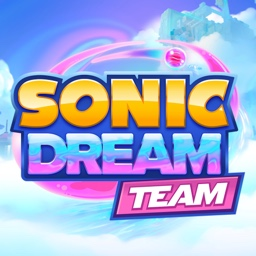
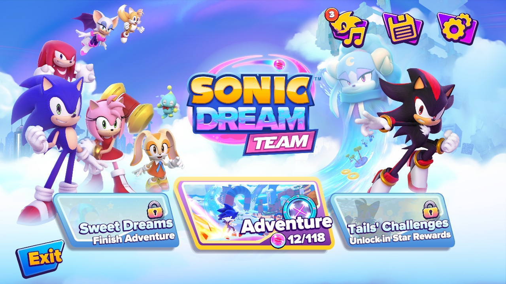
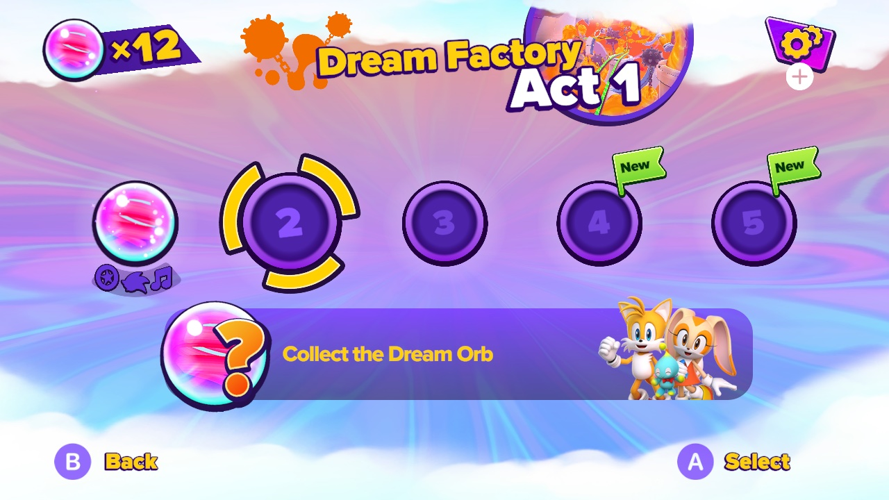

<div align="center">



# projectdream_nx

**Sonic Dream Team on Nintendo Switch**

[](#nintendo-switch)
[](../../releases/latest)




<sub>Left: the main menu. Right: an act select screen, with the Switch's own button icons.</sub>

</div>

---

## About

An unofficial port of **Sonic Dream Team** (SEGA / HARDlight) to the Nintendo Switch (homebrew). It runs the game's
Android build, the one [Project Dream](https://archive.org/details/project_dream) by Beatz makes from the macOS version,
natively on the Switch:

- **Drawn with deko3d**, the Switch's own graphics API (the game's Vulkan renderer on `vkdk`).
- **30, 60 or Auto**: 60, and an even 30 whenever 60 is out of reach.
- **Dynamic Resolution** measured on the GPU itself.
- **HD Rumble** for hits, a life lost, striking enemies, boosts, switching characters and the goal.
- **The Switch's button icons** (L, R, + and -) in place of the controller icons of the PC game.
- **A fourth CPU core** used automatically when a forwarder allows it.

**No game files are included.** You need your own copy of Sonic Dream Team 1.10.1 for macOS and Project Dream; the
port's builder (`projectdream_builder`, for Windows, macOS and Linux) makes the game file from them.

Downloads are on the [Releases](../../releases) page.

## Nintendo Switch

Needs a Switch running [Atmosphère](https://github.com/Atmosphere-NX/Atmosphere) and about 2.5 GB free on the SD card.

1. **Make the game file.** Download `projectdream_builder` for your computer from the [Releases](../../releases) page
   (Windows, macOS or Linux; it comes with the NRO), start it and give it:
   - your **Sonic Dream Team 1.10.1 for macOS** (the `.app`, or a `.zip` of it),
   - your **`Project_Dream.exe`** (Project Dream by Beatz; its GitLab page is gone, a mirror is on the
     [Internet Archive](https://archive.org/details/project_dream)). The builder runs Project Dream's own conversion
     from it, without Windows.

   It downloads Unity's Android player (about 675 MB) from Unity, as Project Dream does, and writes
   `SD_CARD/switch/projectdream_nx/` next to itself: `sdt.apk` and `projectdream_nx.nro`. It needs about 6 GB free
   while it works and takes a few minutes. On macOS, if it is blocked the first time: System Settings, Privacy &
   Security, Open Anyway. On Linux, start it from a terminal (it uses the system's OpenSSL, which desktop
   distributions and SteamOS have).
2. **Copy it to the SD card.** Copy the `switch` folder in `SD_CARD` to the root of the SD card.
3. Start the Homebrew Menu by **holding R while launching any installed game**. The port needs the console's full
   memory; the album applet does not have enough.
4. Start **Sonic Dream Team**.

Already have an `.apk` from Project Dream's own **Android** build (Windows)? From 1.0.2 the port reads its textures
(Project Dream converts them to ASTC for phones), but that route has not been tested on a console yet. The builder's
APK is the one every test used, and it keeps the game's own textures as they are, without a second compression.

The first start extracts the game's libraries from the APK, which takes a little while. Shaders are compiled the
first time they are needed and kept on the SD card, so the first play of each area can stutter briefly. Saves and
settings stay in the same folder (`data/`, `ext/`, `config.txt`).

### Settings

The game's own Settings menu (Project Dream's page) has the Switch's options:

| Option | What it does |
|---|---|
| **Resolution Scale** | How sharp the 3D picture is, 0.50 to 1.00. |
| **Frame Rate** | **30**, **60** or **Auto**: 60, and an even 30 whenever 60 is out of reach. A 60 Hz screen only shows these two smoothly. |
| **Dynamic Resolution** | Lowers the resolution only while the GPU is the limit, never below 0.70 and never above Resolution Scale. |
| **Vibration** | HD Rumble on or off. |

`config.txt` next to the NRO has more, each explained in the file. For example, `rumble` sets the HD Rumble strength
in percent, `docked_1080 1` draws at 1080p on a TV (720p by default, scaled up by the console), and `fixed_step 0.02`
runs physics at 50 Hz for a little more speed.

### Performance

Measured on one console in handheld mode:

| Clocks | Frame rate |
|---|---|
| **Stock** (CPU 1020 MHz, GPU 460 MHz) | **30** in levels (Frame Rate Auto or 30), with an occasional dropped frame in the heaviest spots. |
| **CPU 1785 MHz** (GPU 768 MHz, or 460 MHz with Resolution Scale near 0.70) | **50 to 60** in levels. |

The limit is the main thread, which runs the game's own code, so 60 needs an overclocked CPU (Horizon OC, sys-clk).
The port never sets the clocks itself. Docked, the console draws at 720p too: 1080p is 2.25 times the pixels.

A forwarder with **4 CPU cores** gives the engine one more worker thread, which the port uses by itself. In sphaira:
select the NRO, Options, Install Forwarder, CPU Cores 4.

With SaltyNX installed, [Status Monitor Overlay](https://github.com/masagrator/Status-Monitor-Overlay) shows the frame
rate and resolution.

## What is in this repository

This repository holds the port's own code. The game's code and assets are SEGA's and are not included.

| Folder | What it is |
|---|---|
| `source/` | `projectdream_nx`, the Switch homebrew loader that runs the game's Android build (arm64): the ELF loader, Android and Java layers, Project Dream's options, dynamic resolution, HD Rumble and the setup screen. |
| `vkdk/` | Vulkan on deko3d: the Vulkan subset Unity draws with, its shader translation (SPIRV-Cross to GLSL, compiled by `vkdk/uam/`) and the Vulkan headers. |
| `tools/builder/` | `projectdream_builder` (C#, .NET): makes `sdt.apk` from the player's macOS game and their own `Project_Dream.exe`, running Project Dream's conversion code from that exe (none of it is in this repository) and Unity's Android player downloaded from Unity. `publish.sh` makes the release builds. |
| `tools/` | `build_vkdk.sh`, `package.sh`, the button icon maker (`switch_glyphs.py`, `embed_glyphs.py`), the shader cache merger and helpers for hardware logs and Ryubing. |
| `PLAN.md` | The development log: how Project Dream's Android build works, what the port does at each step, and every hardware round's findings. |

### Building

Needs devkitPro with devkitA64, libnx, deko3d and the `switch-ffmpeg`, `switch-dav1d`, `switch-bzip2` and
`switch-zlib` packages, plus CMake and Ninja for vkdk.

```sh
tools/build_vkdk.sh     # builds vkdk, uam and SPIRV-Cross into build_vkdk/
make                    # builds projectdream_nx.nro
```

Put `projectdream_nx.nro` and the game's `.apk` in `/switch/projectdream_nx/` on the SD card.

The builder needs the .NET SDK (10 or newer):

```sh
dotnet run --project tools/builder -- --mac <game .zip or .app> --pd <Project_Dream.exe>
tools/builder/publish.sh projectdream_nx.nro release/   # self-contained builds for Windows, macOS and Linux
```

## Credits

- **SEGA and HARDlight**: Sonic Dream Team.
- **Beatz**: Project Dream, the game's Android build and its loader, which this port runs.
- **Andy Nguyen (TheFloW), fgsfds and GoatHonks**: the so-loader the Switch loader started from.
- **gm666q**: the pthread layer from lswtcs-vita.
- **StevensND**: the SaltyNX template from nfsmw-nx.
- **devkitPro (fincs)**: libnx, deko3d and uam.
- **The SwitchWakerHD port**: its uam patches.
- **Thorhax**: [SonicDreamTeam-NX](https://github.com/Thorhax/SonicDreamTeam-NX), whose measurements suggested the
  engine thread setup used here.
- **Port**: aks796.

Third-party licences are listed in [THIRD_PARTY_NOTICES.md](THIRD_PARTY_NOTICES.md).

This is a fan project, not affiliated with or endorsed by SEGA, HARDlight, Nintendo, Unity or Apple. Sonic the
Hedgehog and related characters are trademarks of SEGA.

## License

- **`projectdream_nx.nro` and `vkdk/`:** GPL-3.0 ([LICENSE](LICENSE)), because they include GPL-3.0 code.
- **`source/` and `tools/`:** MIT ([source/LICENSE](source/LICENSE)), where a file's header says so.
- **Third-party parts:** their own licences ([THIRD_PARTY_NOTICES.md](THIRD_PARTY_NOTICES.md)).
